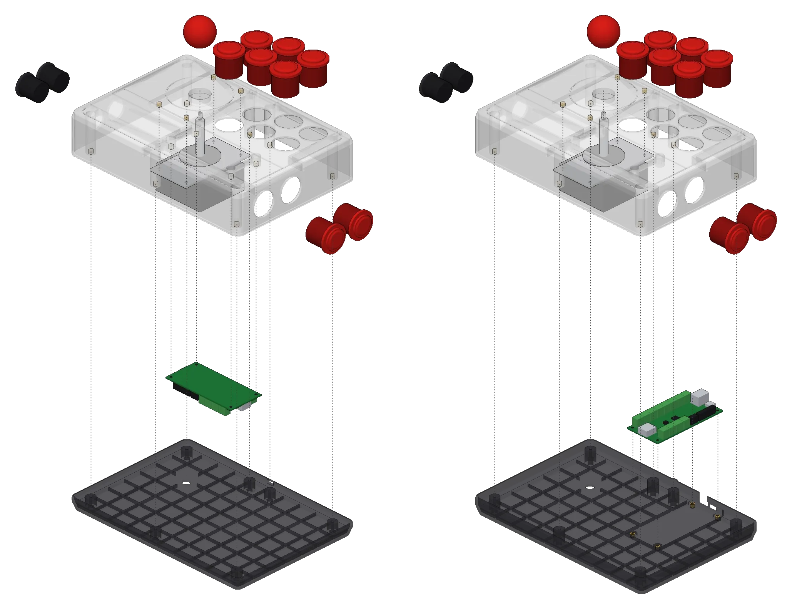
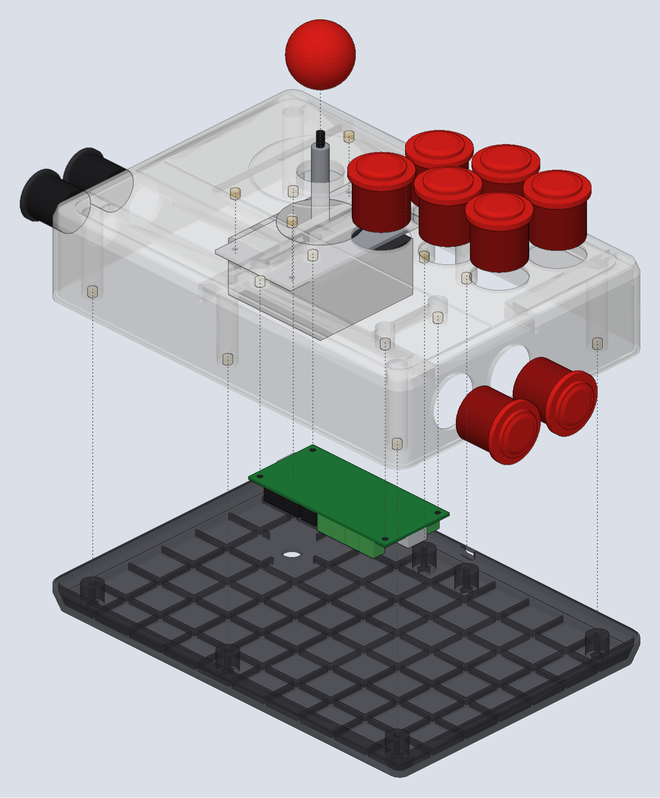
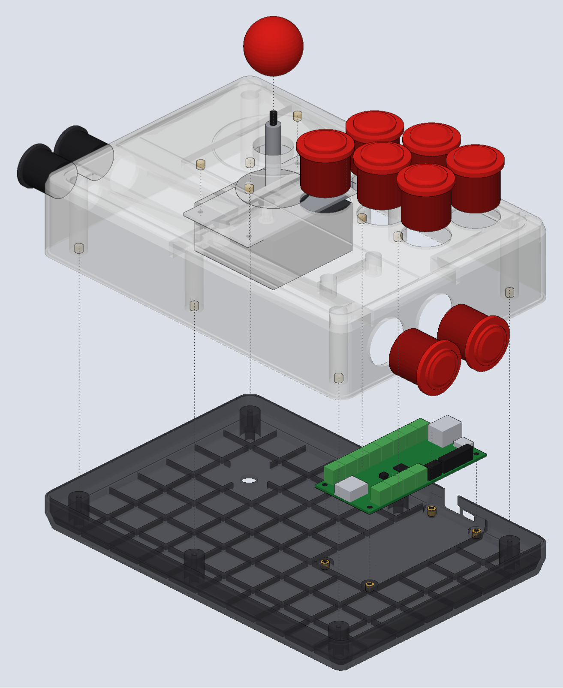

# fightstick-customized

A 3D-printable arcade stick (fight stick) enclosure that you can reshape by editing numbers instead of
wrestling with a CAD program. One Python script builds the whole thing in FreeCAD: the top shell with the button
and joystick holes, and a bottom case that screws on from underneath. Change a parameter, rerun the script, print
the new STL.

It's built around parts you can buy anywhere: Sanwa-style 30 mm snap-in buttons, a Sanwa JLF-style lever (or one
of the many clones), and a GP2040-CE "RP2040 Advanced Breakout" board for USB. No supports needed for either
part.



## What's in the box

Three print files are the "official" ones:

| File | What it is |
| --- | --- |
| `Arcade-stick_top_v7.stl` | The top shell. Six 30 mm buttons on the face, two more through the right end wall, two 24 mm buttons through the left wall, and the joystick. The GP2040-CE board hangs under the top on four posts. |
| `Arcade-stick_bottom_v7.stl` | The plain bottom tray. Has a grid of pockets in the floor that you can fill with pennies and resin for weight. A USB cable comes out a slot in the back. |
| `Arcade-stick_bottom_board_v1.stl` | An alternate bottom where the board sits on the floor and its USB-C and USB-B ports poke straight out the back wall. No cable inside the case. Use this one *instead of* the plain tray, with the same top. |

Here's how each one goes together. Left is the plain tray with the board hanging under the top; right is the
board base with the board on the floor and the ports out the back. The brass bits are heat-set inserts and the
dotted lines are screws.

| Plain tray | Board base |
| --- | --- |
|  |  |

If the animation up top isn't playing for you, `exploded_assembly.mp4` is the same thing as a plain video.

Then there are two samples in `samples/`, mostly to show what the script can do:

- `Arcade-stick_top_v7_sample_8btn.stl` puts all eight 30 mm buttons on the top face and drops the side buttons.
- `Arcade-stick_top_v7_sample_diamond.stl` is the standard layout without the side buttons, with a diamond-plate
  texture pressed into the palm rest.

And `GP2040_post_test_jig.stl` is a tiny plate with the four board posts on it. Print it first (ten minutes) and
set your board on it. If the holes line up, they'll line up on the shell too.

The rest of the folder is pictures, an assembly animation, and the scripts that make them. You can ignore all of
that unless you're curious.

## Hardware you'll need

- 30 mm snap-in buttons (Sanwa OBSF-30 or clones). The top plate is 2 mm thick, which snap-ins love.
- 24 mm snap-in buttons for the two on the left wall (start and select, or whatever you like).
- A Sanwa JLF or a clone with the standard 40 x 80 mm mounting pattern. The lever bolts up under the top with
  M3 screws into heat-set inserts, so there are no screws showing on the face.
- A GP2040-CE RP2040 Advanced Breakout board.
- M3 heat-set inserts, 5 mm outside diameter, 4 mm long. You'll want about 15 of them.
- M3 x 16 to 20 socket-head cap screws for the seven lid screws, plus short M3s for the lever and the board.
- Optional: pennies and UV resin if you want the plain tray to have some heft.

## Printing

Print the top shell **face down**. Print either bottom **floor down**. Neither needs supports; every overhang
was designed for that orientation. A 0.4 mm nozzle and 0.2 mm layers are fine. The shell is about 250 x 175 mm,
so you'll need a bed at least that big.

## Making it your own

This is the fun part. Everything that matters is in one block near the top of `scripts/arcade_stick.py`, a
Python dictionary called `P`. Change what you want, rerun the script, and you get new files. A few favorites:

**Move the buttons.** `BUTTONS30` is a list of (x, y) centers for the top buttons. x runs left to right, y runs
front to back, and (0, 0) is the middle of the top face. Add a pair, remove a pair, nudge one. Keep about 36 mm
between neighboring centers or the button rims will touch.

**Side buttons.** `RIGHT_WALL_BTNS_Y` and `LEFT_WALL_BTNS_Y` are lists of y positions along the end walls. An
empty list means no buttons on that wall.

**Your joystick.** `JOY` is the shaft center, `JOY_DX` and `JOY_DY` are the mounting hole spacing (40 x 80 for a
JLF). If your clone's plate is a different size, `JOY_PAD_W` and `JOY_PAD_L` should be the plate size plus 4 mm.

**Your board.** `BOARD_HOLES` are the four mounting hole positions for the board that hangs under the top. The
`B2_*` block describes the same board for the on-the-floor base: outline size, hole inset, and where the USB
ports are along the back edge.

**Your inserts.** `INSERT_HOLE_R` is half the hole diameter for the heat-set inserts. The defaults are for 5 mm
OD inserts in a 4.4 mm hole; if yours are loose or tight, this is the one number to change.

**The box itself.** `X` is half the width, `YF` and `YB` are the front and back walls, `ZBOT` is how tall the
shell is. The tray follows automatically.

Comments in the script explain the rest, and `AGENTS.md` has step-by-step recipes for the bigger changes (an
eight-button layout, a different lever, a different PCB, different inserts) if you want more detail.

## Building the STLs

You need FreeCAD 1.x. The script runs headless, no GUI, through FreeCAD's command-line interpreter.

If FreeCAD is installed as a Flatpak (Linux):

```sh
flatpak run --filesystem=home --command=freecadcmd org.freecad.FreeCAD scripts/arcade_stick.py
```

If you have a regular install, it's just:

```sh
freecadcmd scripts/arcade_stick.py
```

Add `shell`, `tray` or `board` after the script name to build only one part. The script prints a line per part
that should say `valid=True solids=1` and `mesh solid=True`, then `ALL OK` at the end. If you see `PROBLEMS`,
something you changed made two features collide or left a sliver; the message above it usually says which part.

Takes about a minute per part. The `.FCStd` and `.stl` files land in the project folder with the names set at
the bottom of the script, so bump the version in those names when you make something new and the old ones stay
around.

The two samples are built the same way with `scripts/samples.py`, which is also a decent example of how to try
a variation without touching the main script.

## A couple of honest notes

- Measure your buttons. The clearances assume a 30 mm button body is no more than 34 mm across under the panel.
  Real Sanwas are a little smaller, which only helps.
- The joystick body is assumed to be no bigger than 65 mm square around the shaft. Some clones are chunkier; if
  yours is, slide the left-wall buttons forward a bit.
- The board hole pattern came from the GP2040-CE v5.3E drawings. Print the test jig before the shell.

Have fun, and if you make something cool with it, I'd love to see it.
